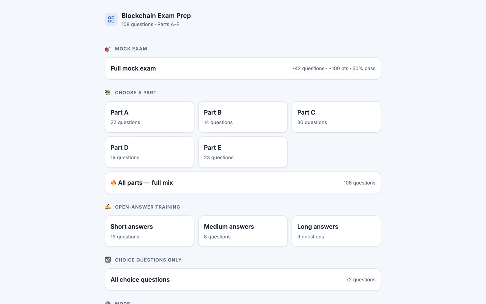
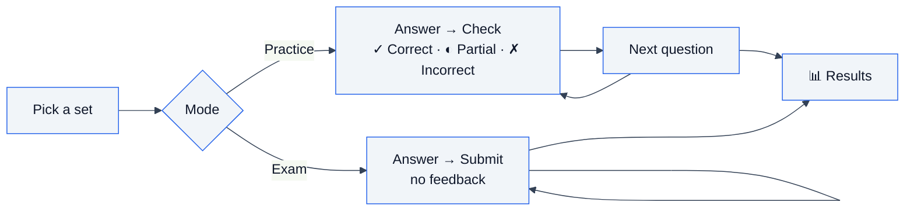

<div align="center">



# ⛓️ Blockchain Quiz

**An exam-prep quiz I built for the Blockchain course final exam: 108 exam questions, a mock exam and free-text answers graded by keywords.**

<p align="center">
  <a href="https://blockchain-quiz-mu.vercel.app"></a>
  
</p>

<p align="center">
  
  
  
  
</p>

</div>

---

## 🎯 What's inside

| | |
| --- | --- |
| **Questions** | 108 in total, split into parts A–E |
| **Question types** | Single choice, multiple choice and written answers |
| **Choice questions** | 72 |
| **Written answers** | 36, grouped into short, medium and long |

| Set | What it is |
| --- | --- |
| 🎯 **Mock exam** | ~42 random questions worth ~100 points, 50% to pass, always in Exam mode |
| 📚 **Parts** | Any single part, or 🔥 all parts mixed together |
| ✍️ **Open-answer training** | Only written questions, by answer length |
| ☑️ **Choice only** | Every single and multiple choice question, no free text |

## 🔁 Two modes



- **Practice**: instant feedback after every question, with the points you got.
- **Exam**: no hints until the end; 80% to pass (50% for the mock exam).

## 🧮 How answers are scored

| Type | Scoring |
| --- | --- |
| Single choice | 1 point for the right option |
| Multiple choice | +1 for each right option, −1 for each wrong one, never below 0 |
| Written answer | Keyword matching against the model answer, worth the `[N]` points shown in the question |

Written answers are forgiving on purpose: words are stemmed (`ies → y`, `-ing`, `-ed`, `-s`), common stop words
are ignored, and a typo of one letter is accepted in words of 4+ characters (Levenshtein distance ≤ 1).

## 🛠️ Run it

No build step and no dependencies: open `index.html` in a browser, or serve the folder with any static server.
Questions live in `questions.json` (and `questions.js` for opening the file directly).

```bash
npx serve .
```

<div align="center">

**Blockchain Quiz** · built for one exam, kept for the next student 📝

</div>
